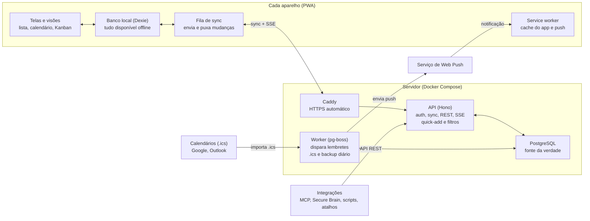

# Estrutura de um app pessoal inspirado no TickTick

> Cópia do documento de planejamento de 24/11/2026 (Claude Docs: https://claude.ai/artifact/EwWeoqWWwSGDBNjHhFbeQ4).
> Os diagramas foram transcritos em Mermaid. Trechos que já mudaram estão em `docs/project/status.md` e nos ADRs.

## Resumo

Dá para construir um app pessoal com praticamente tudo que o TickTick oferece, desde que seja em fases: primeiro tarefas, listas e lembretes; depois calendário e visões (Kanban, Eisenhower, linha do tempo); por fim hábitos, foco (Pomodoro) e IA. A proposta é um **PWA offline-first** (roda no navegador, instala no celular e no Windows) com **backend self-hosted em Docker** e banco **PostgreSQL**.

O TickTick junta num único app lista de tarefas, calendário, Kanban, linha do tempo, matriz de Eisenhower, hábitos, Pomodoro, contagem regressiva e recursos de IA, com sync entre celular, computador, tablet e relógio ([ticktick.com](https://ticktick.com/)). Como o seu app é para uma pessoa só, tudo que é de equipe (compartilhar listas, atribuir tarefas, comentários, histórico de atividade) sai do escopo, o que simplifica muito o sync e a autenticação.

## Análise do TickTick: mapa de funcionalidades

O TickTick tem 14 módulos; 13 fazem sentido para uso pessoal. A tabela abaixo é o inventário que serve de checklist para o seu app.

| Módulo | O que faz no TickTick | Detalhes que importam para replicar |
|---|---|---|
| Captura rápida | Adicionar tarefas de qualquer lugar | Linguagem natural reconhece data/hora enquanto você digita; entrada por voz; atalho global no desktop; widget na tela inicial; extensão de navegador e e-mail |
| Tarefas | A unidade básica | Título, notas em Markdown com imagens, 4 níveis de prioridade, tags, data/hora, duração, subtarefas (até 5 níveis), checklist dentro da tarefa, anexos, templates, status "Não vou fazer" |
| Organização | Onde as tarefas moram | Listas, pastas que agrupam listas, Inbox, listas inteligentes nativas (Hoje, Amanhã, Próximos 7 dias, Tudo, Concluídas, Lixeira) e filtros personalizados (ex.: alta prioridade desta semana) |
| Visões | Jeitos de ver a mesma lista | Lista em 3 colunas, Kanban por agrupamento, Linha do tempo (Gantt leve, arrastar para mudar duração), Matriz de Eisenhower, Sticky Note, Split View |
| Calendário | Tarefas e eventos no tempo | Visões anual, mensal, semanal, diária, agenda, multi-dia e multi-semana; assinatura de calendários externos; integração com Google Calendar |
| Lembretes | Notificações | Vários horários por tarefa; recorrência semanal, mensal, anual ou personalizada; lembrete constante (toca até concluir); por e-mail; por localização (só iOS); lembrete diário para planejar o dia |
| Hábitos | Rastreador de hábitos | Biblioteca de hábitos, meta de frequência (diária, semanal ou personalizada), check-in com nota e emoji, sequências (streaks), estatísticas e lembretes |
| Foco | Pomodoro integrado às tarefas | Pomodoro de 25 min com pausa, cronômetro progressivo, ruído branco, sessão ligada a uma tarefa, estatísticas por dia, semana, mês, lista e tag |
| Contagem regressiva | Datas importantes | Aniversários, provas, prazos de projeto |
| Estatísticas | Painel de progresso | Tarefas concluídas, tempo de foco, registros de hábitos |
| IA | Assistente e automações | Voz que cria várias tarefas já com data e prioridade; resumo de gravações; assistente que quebra projetos em tarefas; automações via MCP e CLI |
| Personalização e atalhos | Conforto de uso | Mais de 40 temas, fundo por lista, fuso horário, atalhos de teclado e menu de comandos |
| Sync e plataformas | Mesmos dados em todo lugar | Sync em tempo real entre celular, computador, tablet e relógio |
| Colaboração | Uso em equipe | Compartilhar listas, atribuir tarefas, comentários, histórico de atividade (fora do escopo pessoal) |

No plano grátis o TickTick limita a 9 listas, 99 tarefas por lista, 2 lembretes por tarefa e 5 hábitos; o Premium custa US$ 49,99/ano. No seu app esses limites não existem.

Fontes: [ticktick.com](https://ticktick.com/), [página de funcionalidades](https://ticktick.com/features), [planos e preços](https://ticktick.com/upgrade), [blog: Focus e cronômetro](https://blog.ticktick.com/2020/05/06/brand-new-focus-experience-ticktick/), [Product Hunt: subtarefas aninhadas](https://www.producthunt.com/p/ticktick/ticktick-task-nesting).

## Escopo do app pessoal

O MVP cobre o que você usa todo dia: capturar, organizar, ser lembrado e acessar offline. Calendário e visões vêm na fase 2, hábitos e foco na fase 3, IA na fase 4. Colaboração fica de fora.

| Módulo | Como fica na versão pessoal | Quando |
|---|---|---|
| Captura rápida | Campo único com linguagem natural em português ("amanhã 15h #faculdade !alta") e atalho de teclado no app | MVP |
| Tarefas | Título, notas em Markdown, prioridade, tags, data/hora, duração, subtarefas, checklist e "Não vou fazer"; anexos e templates depois | MVP |
| Listas e listas inteligentes | Inbox, listas, pastas e as listas fixas Hoje, Amanhã, Próximos 7 dias, Tudo, Concluídas e Lixeira | MVP |
| Lembretes e recorrência | Notificação push, vários horários por tarefa, regras de repetição padrão (RRULE); lembrete constante e por e-mail na fase 2 | MVP |
| Offline e sync | O app funciona sem internet e sincroniza sozinho quando a conexão volta | MVP |
| Calendário | Mês, semana, dia e agenda; arrastar para reagendar; assinar calendários externos (.ics) | Fase 2 |
| Kanban, Eisenhower e Linha do tempo | Três visões diferentes sobre as mesmas tarefas, sem dados novos | Fase 2 |
| Filtros personalizados | Listas inteligentes que você monta (ex.: tag faculdade + vence esta semana) | Fase 2 |
| Temas | Claro, escuro e cor de destaque, em vez de 40 temas | Fase 2 |
| Hábitos | Meta de frequência, check-in com nota, sequências e lembretes | Fase 3 |
| Foco | Pomodoro e cronômetro ligados a uma tarefa, ruído de fundo, histórico de sessões | Fase 3 |
| Contagem regressiva e estatísticas | Datas importantes e painel com tarefas concluídas, tempo de foco e hábitos | Fase 3 |
| IA | Captura por voz, assistente que quebra projetos em tarefas e um servidor MCP próprio, que também deixa o Secure Brain ler e criar tarefas | Fase 4 |
| Colaboração | Compartilhar listas, atribuir, comentar | Fora |
| Lembrete por localização e app de relógio | Dependem de app nativo; não compensam no início | Fora |

## Arquitetura

São três blocos: o app em cada aparelho (com banco próprio), um servidor em Docker e alguns serviços externos.



Toda leitura e escrita acontece no banco local do aparelho; a fila de sync conversa com a API quando há rede, e o worker no servidor dispara os lembretes mesmo com o app fechado.

## Stack tecnológica

TypeScript de ponta a ponta: o mesmo código de datas, recorrência e validação roda no navegador (offline) e no servidor, sem reescrever regra em duas linguagens. Tudo sobe com um `docker compose up`.

| Camada | Escolha | Por quê | Alternativa |
|---|---|---|---|
| Front-end | React + Vite + TypeScript, como PWA (vite-plugin-pwa) | Instala no Windows e no celular, funciona offline, um só código | SvelteKit |
| Interface | Tailwind CSS + shadcn/ui + dnd-kit | Componentes prontos e arrastar-e-soltar para Kanban, listas e Eisenhower | Mantine |
| Banco local | Dexie.js (IndexedDB) + Zustand para estado de tela | Consultas locais instantâneas, base do offline-first | RxDB |
| Calendário | FullCalendar (plugins gratuitos: mês, semana, dia, lista) | Visões de calendário prontas com arrastar | Componente próprio |
| Linha do tempo | Componente próprio em CSS Grid | A visão de timeline do FullCalendar é paga | frappe-gantt |
| Datas e recorrência | date-fns, rrule.js (padrão RFC 5545) e chrono-node | rrule é o mesmo formato do Google Calendar e do .ics | Luxon |
| Back-end | Node 22 + Hono + Zod | Leve, tipado, validação compartilhada com o front | Python + FastAPI |
| Banco de dados | PostgreSQL 16 + Drizzle ORM | Migrações tipadas; JSONB para regras de filtro | SQLite |
| Jobs agendados | pg-boss | Fila e agendamento dentro do próprio Postgres, sem Redis | BullMQ + Redis |
| Notificações | Web Push (lib web-push, chaves VAPID); e-mail via Nodemailer na fase 2 | Push nativo no Android, Windows e iPhone | ntfy self-hosted |
| Tempo real | Server-Sent Events | Avisa os outros aparelhos que há mudanças para puxar | WebSocket |
| Login | Senha com Argon2 + cookie de sessão HttpOnly; passkey depois | Um usuário só, sem OAuth | Authelia na frente |
| Infra | Docker Compose (api, web, postgres, caddy) | Caddy dá HTTPS automático, exigido por service worker e push | Traefik |
| Acesso remoto | Tailscale ou Cloudflare Tunnel | Usa no celular fora de casa sem abrir porta no roteador | VPS com domínio |
| Nativo (depois) | Tauri (Windows) e Capacitor (Android) | Atalho global e bandeja no desktop reaproveitando o mesmo front | Electron |
| Testes | Vitest + Playwright | Unitários para recorrência e parser; ponta a ponta para fluxos | Jest |

Três pontos verificados: o chrono-node tem suporte só parcial a português, então o parser precisa de regras próprias para "amanhã", "toda segunda" etc. ([README do chrono](https://unpkg.com/chrono-node@2.10.1/README.md)); o pg-boss exige Node 22.12+ e PostgreSQL 13+ e já traz agendamento por cron e RRULE ([README do pg-boss](https://raw.githubusercontent.com/timgit/pg-boss/master/README.md)); no iPhone, o push só funciona com o PWA adicionado à tela inicial, iOS 16.4 ou superior ([WebKit](https://webkit.org/blog/13878/web-push-for-web-apps-on-ios-and-ipados/)).

## Modelo de dados

São 17 tabelas, e `tasks` concentra quase toda a complexidade. Toda tabela tem as mesmas colunas de sync: `id` (UUID v7 gerado no próprio aparelho, para criar offline), `created_at`, `updated_at`, `server_version` (número crescente atribuído pelo servidor) e `deleted_at` (exclusão lógica, nunca apaga de verdade).

| Tabela | Campos principais | Relações |
|---|---|---|
| `users` | email, password_hash, timezone, settings (JSONB: tema, início da semana, padrões de lembrete) | Dono de tudo |
| `folders` | name, sort_order | Tem várias listas |
| `lists` | name, color, icon, view_mode (lista, kanban, timeline), is_inbox, sort_order, archived | Pertence a uma pasta (opcional) |
| `sections` | name, sort_order | Colunas do Kanban dentro de uma lista |
| `tasks` | title, content (Markdown), status (aberta, concluída, não vou fazer), priority (0 a 3), start_at, due_at, is_all_day, duration_min, timezone, rrule, completed_at, pinned, sort_order | Pertence a lista e seção; `parent_id` aponta para a tarefa-mãe (subtarefas) |
| `task_occurrences` | original_date, overrides (JSONB), status | Exceções de uma tarefa recorrente ("editar só esta") |
| `checklist_items` | title, done, sort_order | Pertence a uma tarefa |
| `tags` | name, color, parent_id | Tags aninhadas; N:N com tarefas via `task_tags` |
| `reminders` | kind (antes do prazo, horário fixo), offset_min ou fire_at, channel (push, e-mail, constante), next_fire_at | Pertence a uma tarefa ou hábito |
| `filters` | name, rules (JSONB com condições E/OU), sort_order | Listas inteligentes personalizadas |
| `habits` | name, icon, goal_type (sim/não ou quantidade), goal_value, unit, frequency, start_date, archived | Tem check-ins e lembretes |
| `habit_checkins` | date, value, note, mood | Um por hábito por dia |
| `focus_sessions` | mode (pomodoro, cronômetro), started_at, ended_at, duration_sec, pauses | Ligada a uma tarefa ou hábito (opcional) |
| `countdowns` | title, date, repeat_yearly, kind | Independente |
| `calendar_subscriptions` | url (.ics), name, color, last_synced_at | Eventos externos ficam em cache, só leitura |
| `push_subscriptions` | endpoint, keys, device_name | Um por aparelho que recebe notificação |

Duas decisões que evitam dor de cabeça: datas sempre em UTC com o fuso guardado à parte (para lembretes certos quando você viaja), e `sort_order` como índice fracionário em texto (biblioteca fractional-indexing), que permite reordenar arrastando sem renumerar a lista inteira.

## API

O app em si conversa com o servidor por só três rotas de sync; a API REST completa existe para integrações (scripts, atalhos do celular, servidor MCP, Secure Brain). Tudo sob `/api`, autenticado por cookie de sessão no app ou token pessoal nas integrações.

| Método | Rota | Para quê |
|---|---|---|
| POST | `/auth/login`, `/auth/logout` | Sessão do único usuário |
| GET | `/sync/pull?since=<versão>` | Tudo que mudou em qualquer tabela desde a última versão que o aparelho viu |
| POST | `/sync/push` | Lote de mutações feitas offline; devolve as aceitas, os conflitos e as novas versões |
| GET | `/sync/events` | Canal SSE que avisa "há versão nova" para os outros aparelhos puxarem |
| GET, POST | `/api/tasks` | Listar com filtros (lista, tag, prazo, status) e criar |
| GET, PATCH, DELETE | `/api/tasks/:id` | Ler, editar e mandar para a lixeira |
| POST | `/api/tasks/:id/complete` | Concluir; numa recorrente, gera a próxima ocorrência |
| POST | `/api/quick-add` | Recebe texto livre ("pagar boleto sexta 10h !alta") e cria a tarefa já interpretada |
| GET | `/api/views/:smart` | Listas inteligentes prontas: today, tomorrow, next7, all, completed, trash |
| CRUD | `/api/lists`, `/api/folders`, `/api/tags`, `/api/filters` | Organização |
| CRUD | `/api/habits`, `/api/habits/:id/checkins` | Hábitos e check-ins |
| CRUD | `/api/focus-sessions`, `/api/countdowns` | Foco e contagens regressivas |
| GET | `/api/stats?from=&to=` | Totais de tarefas, foco e hábitos por período |
| POST, DELETE | `/api/push/subscriptions` | Registrar ou remover um aparelho para notificações |
| GET | `/api/calendar.ics?token=` | Seu feed de tarefas para assinar no Google Calendar ou no celular |
| CRUD | `/api/calendar-subscriptions` | Calendários externos que o app importa |
| POST | `/api/attachments` | Upload de anexos (fase 2) |

Formato de uma mutação enviada no `/sync/push`:

```json
{
  "mutations": [
    {
      "table": "tasks",
      "id": "0193a1b2-...",
      "op": "upsert",
      "fields": { "title": "Estudar cálculo", "due_at": "2026-11-26T18:00:00Z" },
      "client_updated_at": "2026-11-24T13:40:00Z",
      "base_version": 1842
    }
  ]
}
```

## Estrutura do repositório

Um monorepo com pnpm workspaces. O coração é `packages/core`: funções puras (recorrência, parser de linguagem natural, avaliador de filtros, schemas) testadas uma vez e usadas pelo front e pela API.

```text
meu-tick/
├── apps/
│   ├── web/                     # PWA (React + Vite)
│   │   └── src/
│   │       ├── app/             # rotas, layout, barra lateral
│   │       ├── features/
│   │       │   ├── tasks/       # lista, detalhe, quick-add
│   │       │   ├── calendar/
│   │       │   ├── kanban/
│   │       │   ├── matrix/      # Eisenhower
│   │       │   ├── timeline/
│   │       │   ├── habits/
│   │       │   ├── focus/
│   │       │   └── stats/
│   │       ├── db/              # Dexie: schema local e consultas
│   │       ├── sync/            # fila de saída, pull/push, SSE
│   │       ├── components/      # UI compartilhada (shadcn)
│   │       └── sw.ts            # service worker: cache e push
│   ├── api/                     # Hono
│   │   └── src/
│   │       ├── routes/          # auth, sync, tasks, lists, habits...
│   │       ├── db/              # schema Drizzle e migrações
│   │       ├── jobs/            # pg-boss: lembretes, .ics, backup
│   │       ├── notify/          # web push e e-mail
│   │       └── sync/            # aplicação de mutações e conflitos
│   └── mcp/                     # fase 4: servidor MCP
├── packages/
│   └── core/
│       ├── recurrence/          # rrule, próxima ocorrência
│       ├── parser/              # linguagem natural pt-BR
│       ├── filters/             # avaliador de listas inteligentes
│       └── schemas/             # Zod: tipos de todas as entidades
├── infra/
│   ├── docker-compose.yml
│   ├── Caddyfile
│   └── backup/                  # pg_dump agendado
├── docs/adr/                    # registro das decisões de arquitetura
├── .github/workflows/           # CI: lint, testes, imagem Docker
├── pnpm-workspace.yaml
└── README.md
```

## Como resolver as partes difíceis

Oito pontos concentram quase todo o risco técnico. Os três primeiros (sync, recorrência e lembretes) entram no MVP e merecem testes antes de qualquer tela bonita.

### Sync offline-first

- Toda escrita vai primeiro para o Dexie e para uma fila de saída (`outbox`); a tela nunca espera a rede.
- Em segundo plano o app envia a fila em lotes (`/sync/push`) e depois puxa o que mudou (`/sync/pull?since=`). O SSE avisa os outros aparelhos na hora.
- Cada escrita no servidor recebe um `server_version` de uma sequência global. O push manda só os campos alterados, então editar o título no celular e o prazo no PC não conflita; no mesmo campo, vence a edição mais recente.
- Exclusão é lógica (`deleted_at`), senão um aparelho offline "ressuscita" o que você apagou.
- Se não quiser escrever o sync, PowerSync, ElectricSQL e a replicação do RxDB fazem isso prontos. Para um usuário só, o sync próprio cabe em poucas centenas de linhas e você entende cada peça.

### Recorrência

- A regra fica na tarefa como texto RRULE (`FREQ=WEEKLY;BYDAY=MO,WE`), com dois modos como no TickTick: repetir pela data de vencimento ou a partir da data em que você concluiu.
- Ao concluir: grava uma cópia concluída (para histórico e estatísticas) e avança o prazo da tarefa original para a próxima ocorrência.
- "Editar só esta" vira uma linha em `task_occurrences`; o calendário expande as ocorrências futuras só dentro da janela visível, sem gravar nada.
- Calcule sempre no fuso da tarefa e converta para UTC no fim.

### Lembretes e notificações

- O servidor é a fonte da verdade: ao salvar uma tarefa, ele calcula `next_fire_at` de cada lembrete. Um job do pg-boss roda a cada minuto, pega os lembretes vencidos (coluna indexada), envia Web Push para todos os aparelhos e calcula o próximo disparo.
- A notificação traz botões "Concluir" e "Adiar 10 min", tratados no service worker.
- Lembrete constante = o job reenvia a cada poucos minutos até a tarefa ser concluída ou adiada.
- O push precisa mostrar a notificação assim que chega: o Safari revoga a permissão de sites que recebem push sem exibir nada.

### Linguagem natural no quick-add

1. Marcadores com regex: `#tag`, `~lista`, `!alta` / `!média` / `!baixa`.
2. Regras próprias em português antes do chrono: hoje, amanhã, depois de amanhã, segunda, próxima sexta, dia 10, às 15h, 15h30, de manhã, à noite, daqui a 2 dias, fim do mês.
3. Frases de repetição viram RRULE: todo dia, toda segunda e quarta, a cada 2 semanas, todo dia 5.
4. O que não casou vai para o chrono-node em `pt` como reserva.
5. Os trechos reconhecidos ficam destacados no campo enquanto você digita, e somem do título ao salvar.

Mantenha uma planilha de frases de teste com o resultado esperado; cada bug vira uma linha nova.

### Listas inteligentes e filtros

Um filtro é uma árvore JSON, por exemplo `{"all":[{"field":"tag","op":"in","value":["faculdade"]},{"field":"due","op":"within","value":"this_week"}]}`. Um único avaliador em `packages/core` roda contra o Dexie no navegador (offline) e é traduzido para SQL na API. Hoje, Amanhã e Próximos 7 dias são apenas filtros pré-definidos, e datas relativas ("esta semana") são resolvidas na hora de avaliar.

### Foco (Pomodoro)

O timer guarda `started_at` e o fim previsto no IndexedDB e calcula o tempo restante pelo relógio, não contando segundos com `setInterval`; assim sobrevive a fechar a aba. Ao iniciar, o app avisa o servidor, que agenda um push para o fim da sessão, porque o navegador não garante timers em segundo plano. Ruído de fundo é um áudio em loop com Web Audio.

### Hábitos

Frequências: todo dia, dias da semana específicos, X vezes por semana, a cada N dias. O check-in usa a data local (não UTC), senão um check-in às 22h no Brasil cai no dia seguinte. A sequência é calculada voltando de hoje pelos dias programados; em "X por semana", conta-se semana a semana.

### Visões

Kanban, Eisenhower, linha do tempo e calendário são projeções da mesma consulta de tarefas; arrastar em qualquer uma delas é só um PATCH na tarefa. Na matriz, defina a regra uma vez e deixe configurável, por exemplo: importante = prioridade média ou alta; urgente = vence até amanhã.

## Roadmap

Quatro fases, cada uma terminando num app utilizável. Não coloquei datas: o ritmo depende de quantas horas por semana você consegue dedicar.

| Fase 1 · MVP (capturar e lembrar) | Fase 2 · Visões | Fase 3 · Rotina (hábitos e foco) | Fase 4 · IA e apps nativos |
|---|---|---|---|
| Quick-add em português | Calendário mês/semana | Hábitos e sequências | Captura por voz |
| Listas, tags e pastas | Kanban e Eisenhower | Pomodoro e cronômetro | Assistente de projetos |
| Subtarefas e checklist | Linha do tempo | Ruído de fundo | Servidor MCP |
| Listas inteligentes | Filtros personalizados | Contagem regressiva | Uso pelo Secure Brain |
| Lembretes e repetição | Lembrete constante | Painel de estatísticas | Tauri: atalho global |
| Offline e sync | Anexos e importador | | Capacitor (Android) |
| Deploy com Docker | | | |

Entre uma fase e outra: **2 semanas de uso real**.

O critério para avançar é sempre o mesmo: usar a fase anterior de verdade por duas semanas e corrigir o que incomodou antes de abrir a próxima.

## Riscos, decisões em aberto e próximos passos

O maior risco não é técnico: é o escopo crescer e o app nunca virar o seu app do dia a dia. Por isso o MVP é pequeno e você deve começar a usar assim que ele existir.

| Risco | Impacto | Como mitigar |
|---|---|---|
| Servidor desligado | Lembretes não disparam se a API roda no seu PC e ele está desligado | Hospedar numa VPS pequena ou num mini-PC sempre ligado; o PC fica para desenvolvimento |
| Push no iPhone | Só funciona com o PWA adicionado à tela inicial | Testar cedo no seu celular; se for Android ou Windows, sem restrição |
| Perda de dados | Um bug de sync ou disco quebrado apaga suas tarefas | `pg_dump` diário com cópia fora da máquina e exportação em JSON pelo próprio app |
| Exposição na internet | Login atacado por força bruta | Acesso só pela Tailscale, ou HTTPS com limite de tentativas no login |
| Escopo infinito | O projeto para no meio | Fases fechadas: nada da fase 2 entra antes de usar o MVP por duas semanas |

### Decisões em aberto

- Onde hospedar: VPS ou máquina em casa sempre ligada?
- App separado ou módulo do Secure Brain? Sugestão: app separado com API e MCP limpos, que o Secure Brain consome.
- PostgreSQL ou SQLite? Postgres é o padrão deste documento por causa do pg-boss.
- Seu celular é iPhone ou Android? Isso define as limitações de notificação.
- Vai importar tarefas de outro app (TickTick, Todoist)? Se sim, um importador entra na fase 2.

### Próximos passos

- Criar o monorepo (pnpm) e o `docker-compose.yml` com Postgres e Caddy
- Escrever `packages/core/recurrence` e `packages/core/parser` com testes antes das telas
- Modelar `lists`, `tasks`, `tags` e `checklist_items` no Drizzle e no Dexie
- Implementar `/sync/pull` e `/sync/push` com a fila de saída no front
- Tela de lista em 3 colunas com quick-add
- Web Push e o job de lembretes no pg-boss
